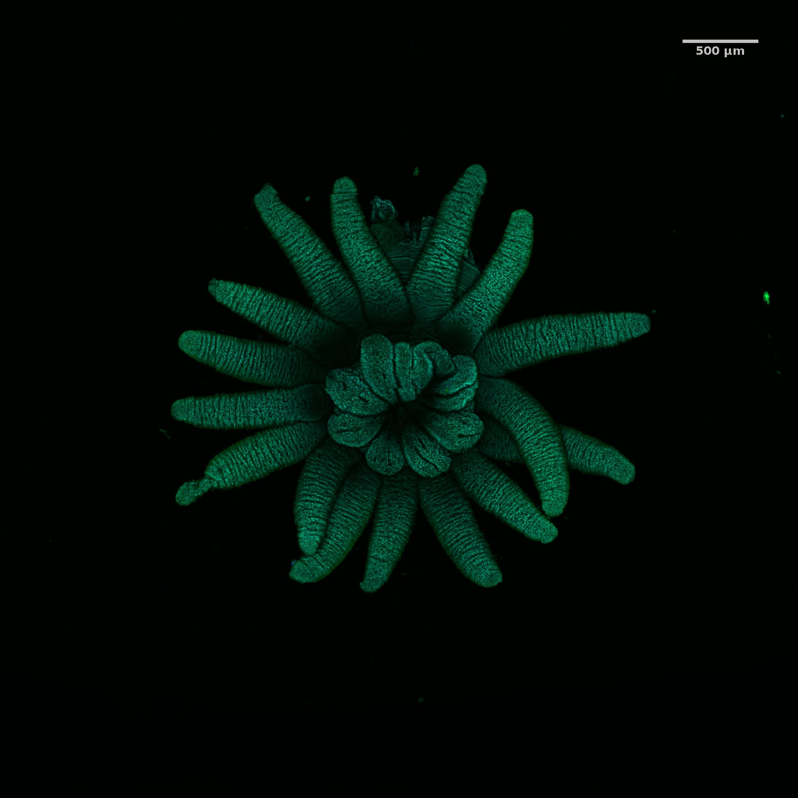
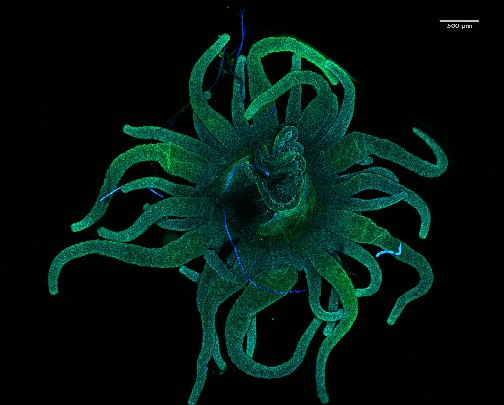
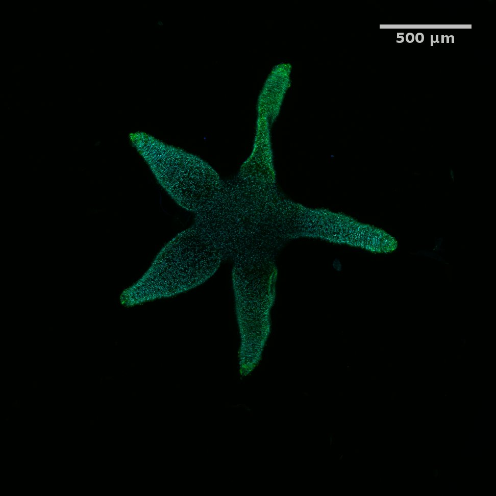

## Imaging

Head crowns of three cnidarians, stained for actin (phalloidin) and nuclei (DAPI) during the final module of the Embryology: Concepts and Techniques in Modern Developmental Biology course at the [Marine Biological Laboratory](https://www.mbl.edu/), Woods Hole (2022). Imaged on an LSM 780 confocal with a 10× objective. Click an image to see it full size.

<!-- To add an image: upload it to assets/microscopy/, then copy one <figure> block
     and change the file name (twice), the alt text and the caption. -->

  <figure>
    
    <figcaption><em>Nematostella vectensis</em></figcaption>
  </figure>
  <figure>
    
    <figcaption><em>Aiptasia</em></figcaption>
  </figure>
  <figure>
    
    <figcaption><em>Hydra</em></figcaption>
  </figure>

## Code

Analysis tools for quantifying signaling and segmentation in the zebrafish notochord.

**[notochord_oscillator](https://github.com/padhyapok/notochord_oscillator)** 
Calculation of Erk activity from segmented cells and nuclei in Cellpose.

**[segmentation_index](https://github.com/padhyapok/segmentation_index)** 
Quantifying sequential order of notochord segments.

**[notochord_area_plotter](https://github.com/padhyapok/notochord_area_plotter)** 
Quantifying notochord segment features.
